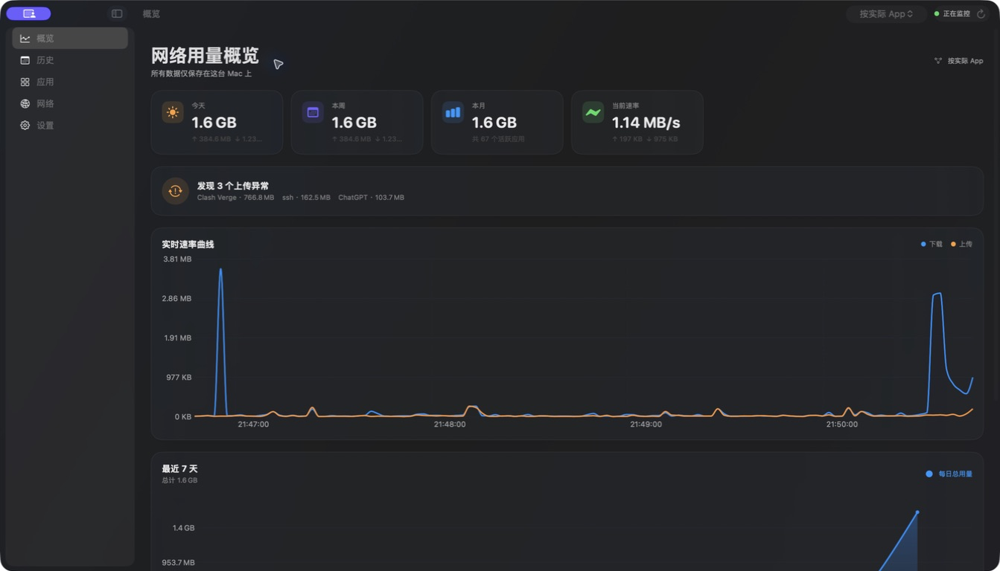
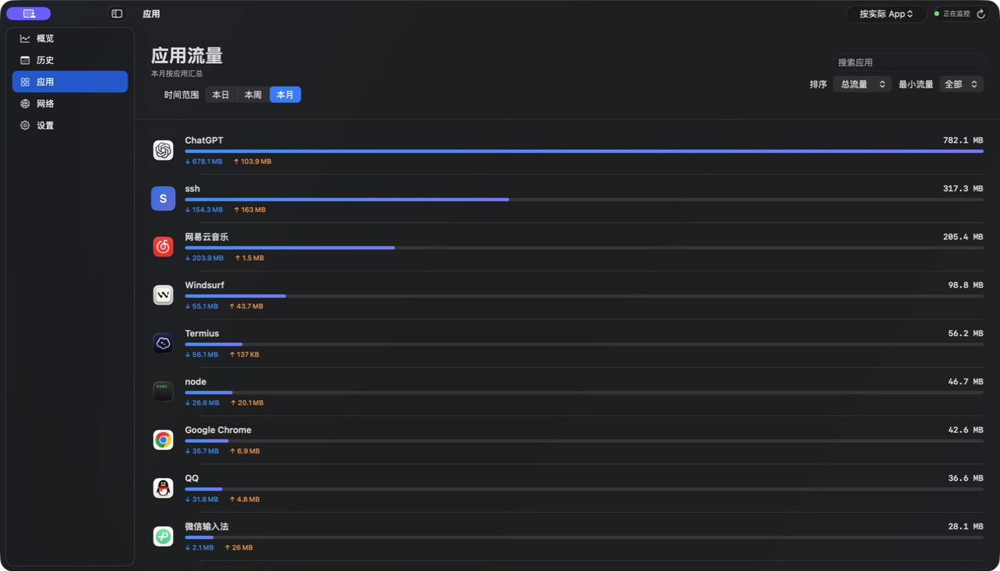
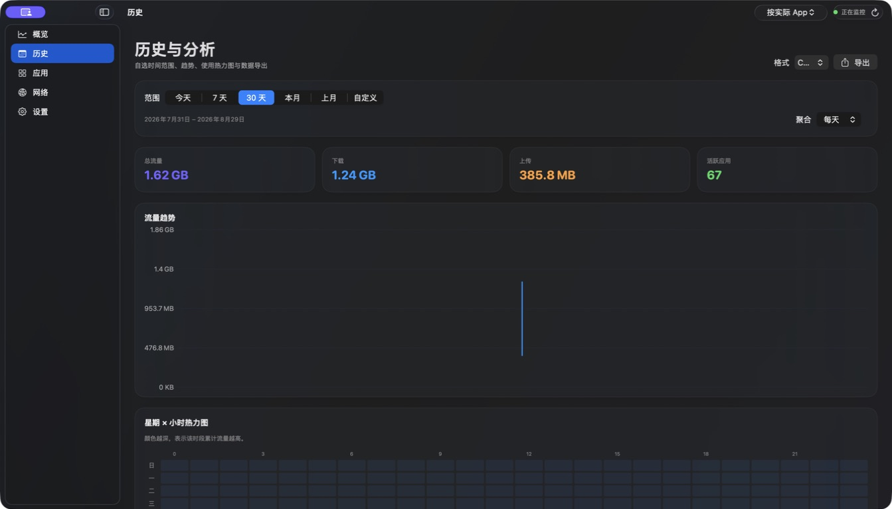
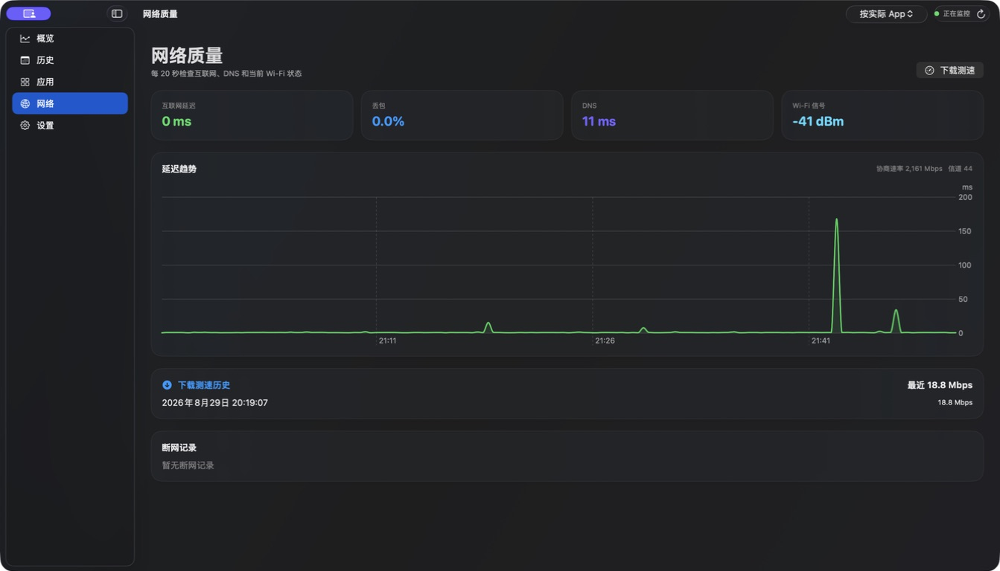
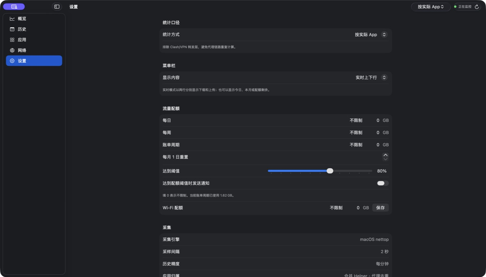

# TrafficMonitor

TrafficMonitor 是一款原生 macOS 菜单栏流量监控应用，提供实时上下行速率、应用流量归属、历史趋势、配额预警和网络质量检测。所有统计数据均保存在本机。

## 下载与安装

[**前往 Releases 下载最新 DMG**](https://github.com/3241288994/TrafficMonitor/releases/latest)

1. 下载并打开 `TrafficMonitor-0.9.2.dmg`。
2. 将 `TrafficMonitor.app` 拖入 `Applications` 文件夹。
3. 首次启动时，请右键点击应用并选择“打开”。

Release 同时提供 SHA-256 校验文件。当前安装包使用临时签名，未经 Apple 公证；源码、构建配置和发布版本完全公开。

## 界面预览

### 网络用量概览

一屏查看今日、本周、本月用量，当前速率、异常上传和实时趋势。



### 应用流量

按本日、本周或本月查看应用排名，分别展示下载、上传和总流量。



### 历史与分析

支持预设或自定义时间范围、多种聚合粒度、趋势图、星期 × 小时热力图与 CSV/JSON 导出。



### 网络质量

持续检查互联网延迟、丢包、DNS、Wi-Fi 信号，并记录下载测速和断网事件。



### 本地化设置

可切换统计口径和菜单栏内容，配置日、周、账单周期及独立 Wi-Fi 配额。



## 功能

- 菜单栏实时上传、下载速率
- 按日、周、月查看流量与应用排行
- 辅助进程与命令行进程的应用归属
- “按实际 App / 按网络出口 / 诊断模式”三种统计口径
- SQLite 本地历史记录与 CSV/JSON 导出
- 流量配额、用量预测与通知
- 延迟、丢包、DNS、Wi-Fi 状态与下载测速
- 折线图和热力图交互查看具体数值

## 开发

要求 macOS 14 或更高版本以及完整 Xcode。

```bash
cd TrafficMonitor
swift test
xcodegen generate
open TrafficMonitor.xcodeproj
```

更详细的使用方式和当前实现范围请参阅 [TrafficMonitor/README.md](TrafficMonitor/README.md)。

## 数据与隐私

历史数据保存在 `~/Library/Application Support/TrafficMonitor/traffic.sqlite`，应用不会将流量数据上传到服务器。

TrafficMonitor 当前使用 macOS `nettop` 获取进程级流量。在代理、VPN 和辅助进程场景中，逐 App 归属是近似值，不应视为运营商账单级计量。

## License

[MIT](LICENSE)
