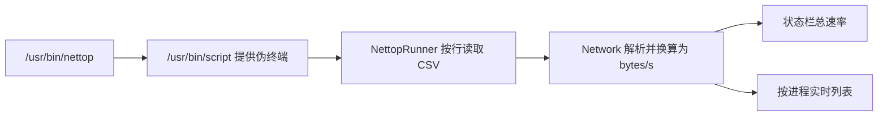

# macOS 流量监控应用：技术调研与 MVP 方案

更新日期：2026-08-29

## 1. 调研范围

- 开源参考项目：`foamzou/ITraffic-monitor-for-mac`，本地副本位于 `reference-ITraffic/`。
- 已安装参考应用：`/Applications/Bytetally.app`。
- ByteTally 仅检查公开可见的应用包结构、签名权限、系统扩展声明、资源和用户界面文案；不反编译、不复制其私有实现。

## 2. 开源项目结论

该项目采用 Swift、SwiftUI 与 AppKit，无第三方运行时依赖，最低支持 macOS 10.15，许可证为 MIT。

### 采集链路



关键实现：

- `nettop -P -d -J bytes_in,bytes_out -t external -s 2 -c` 每 2 秒输出一次按进程的收发增量。
- 必须通过 `/usr/bin/script -q /dev/null` 给 `nettop` 提供伪终端，并保持标准输入管道存活，否则 `nettop` 可能持续高占用 CPU。
- `-d` 输出的是采样窗口内的字节增量，不是每秒速率；应只在采集边界除以采样秒数一次。
- 第一个采样帧是自开机以来的累计值，必须丢弃。
- 进程图标优先使用 `NSRunningApplication`；命令行进程可沿父进程树向上查找宿主应用。
- 状态栏使用 `NSStatusItem`，弹层使用 `NSPopover + NSHostingController`。

### 适用范围

适合：

- 无需特殊系统权限的菜单栏实时上传/下载速率。
- 当前活跃进程排行。
- 非沙盒、Developer ID 方式分发的小工具。

不适合直接承担：

- Mac App Store 沙盒版本：沙盒应用不能依赖任意启动 `/usr/bin/nettop`。
- VPN、本机代理场景下的可靠原始应用归因。
- 网站、域名、连接维度的归因。
- 精确阻断或限速。
- 长期历史统计：可以把采样结果落库，但进程身份、代理重复计量、休眠和采样丢帧需要另行设计。

## 3. ByteTally 的公开架构信号

已安装版本为 1.3.0，最低系统版本为 macOS 14，主程序和辅助程序均为 arm64/x86_64 通用二进制，应用启用了沙盒。

应用包包含：

- 一个 Content Filter Network System Extension，对应 `NEFilterDataProvider`。
- 一个 Transparent Proxy Network System Extension，对应 `NETransparentProxyProvider`。
- 一个 LaunchAgent watchdog 辅助程序。
- App Group，用于主程序与受控组件共享应用数据。
- GRDB 资源和系统 SQLite 链接，说明历史数据采用 SQLite 系列存储方案。
- Charts、CoreWLAN、CoreLocation、NetworkExtension、SystemExtensions、ServiceManagement 等系统框架。

这些信息支持如下判断，但不代表掌握其私有实现：

- Content Filter 负责观察连接流、识别来源应用，并可做放行/阻断决策。
- Transparent Proxy 适合承载需要转发数据的平滑限速能力。
- 主程序负责聚合、查询、图表和设置；持久化使用 SQLite。
- Wi-Fi 名称需要 CoreWLAN，并受定位权限约束。

## 4. 推荐产品路线

不要一开始同时实现“实时监控、历史、域名归因、限速”。建议分两层交付。

### 阶段 A：可快速交付的 MVP

目标：先做一个稳定、低耗电、无需特殊权限的菜单栏工具。

功能范围：

1. 菜单栏显示总上传/下载速率。
2. 弹层显示实时应用/进程排行、图标和速率。
3. 可切换采样周期、显示单位、菜单栏布局。
4. 登录时启动。
5. 本地保存分钟级流量，提供今日/本周总量和简单折线图。
6. 暂不承诺 VPN/代理后的准确应用归因，不提供阻断和限速。

技术选择：

- Swift 6、SwiftUI + 必要的 AppKit 桥接。
- 最低 macOS 14；界面可直接使用现代 SwiftUI、Charts 和 `MenuBarExtra`，不背负 Catalina 兼容成本。
- `TrafficCollector` 协议隔离采集实现，首个实现为 `NettopCollector`。
- SQLite/GRDB 保存聚合数据；原始 2 秒采样只短期保留或不落盘。
- Developer ID 签名和公证后直接分发，第一版不走 Mac App Store。

### 阶段 B：系统级增强版

当需求明确需要以下任一能力时，再新增 Network Extension：

- 沙盒及 Mac App Store 分发。
- VPN/本机代理后的可靠应用归因。
- 连接、域名或网站统计。
- 应用/网站阻断、限速、配额。

该阶段需要 Apple Developer Program、Network Extension capability、系统扩展安装/启用流程、真实签名设备测试，以及更严格的隐私与性能验证，成本明显高于阶段 A。

## 5. 建议代码结构

```text
TrafficMonitor/
  App/
    TrafficMonitorApp.swift
    AppDelegate.swift
  Domain/
    TrafficSample.swift
    ProcessIdentity.swift
    TrafficSnapshot.swift
  Collection/
    TrafficCollector.swift
    NettopCollector.swift
    NettopFrameParser.swift
  Aggregation/
    TrafficAggregator.swift
    RetentionPolicy.swift
  Persistence/
    Database.swift
    SampleRepository.swift
  Features/
    MenuBar/
    LiveTraffic/
    History/
    Settings/
  Platform/
    ProcessResolver.swift
    LaunchAtLogin.swift
  Tests/
```

采集层只产生统一模型，UI 和数据库都不直接解析 `nettop`。未来改用 Network Extension 时，上层无需推倒重写。

## 6. 数据模型建议

- `ProcessIdentity`：PID、可执行文件路径、bundle ID、代码签名标识、显示名。PID 不能作为长期身份键。
- `TrafficSnapshot`：采样起止时间、下载字节、上传字节、采集来源、完整性标记。
- `AppTrafficBucket`：按分钟/小时/天聚合，主键使用时间桶 + 稳定应用标识。
- 采样边界统一使用原始字节计数；只有 UI 展示实时值时换算为 bytes/s。
- 使用单调时钟计算采样间隔，墙上时间只用于存储和展示，避免休眠或系统改时造成突刺。

## 7. 必做验证

- CSV 中进程名包含句点、逗号、非 ASCII 字符时仍可正确解析。
- 首帧累计值不会进入实时速率或历史统计。
- `nettop` 异常退出后能退避重启，不形成重启风暴。
- 睡眠/唤醒、网络切换、进程退出和 PID 复用不会产生巨额假流量。
- 菜单关闭时 CPU 与内存保持稳定。
- 总速率和列表各行之和采用相同单位、同一个采样窗口。
- 数据库聚合可幂等重跑，崩溃后不会重复记账。

## 8. 当前环境状态

- 参考源码已下载完成。
- Xcode 26.6 与 XcodeGen 2.46.0 已安装，许可协议已由用户确认。
- 独立的 `TrafficMonitor` 工程已经生成并成功构建。
- SwiftPM 与 Xcode 工程级测试均通过，共 7 个解析测试。
- 真实 `nettop` 集成探针已成功读取并聚合按进程流量。
- Computer Use 的 UI 自动检查仍被 ScreenCaptureKit 捕获错误阻断；构建、进程和集成采集验证不受影响。

## 9. 下一步

当前已完成独立工程、`NettopFrameParser`、`NettopCollector`、领域模型、测试和第一版菜单栏 UI。下一步加入稳定的应用身份解析、历史数据库、时间聚合与图表。
